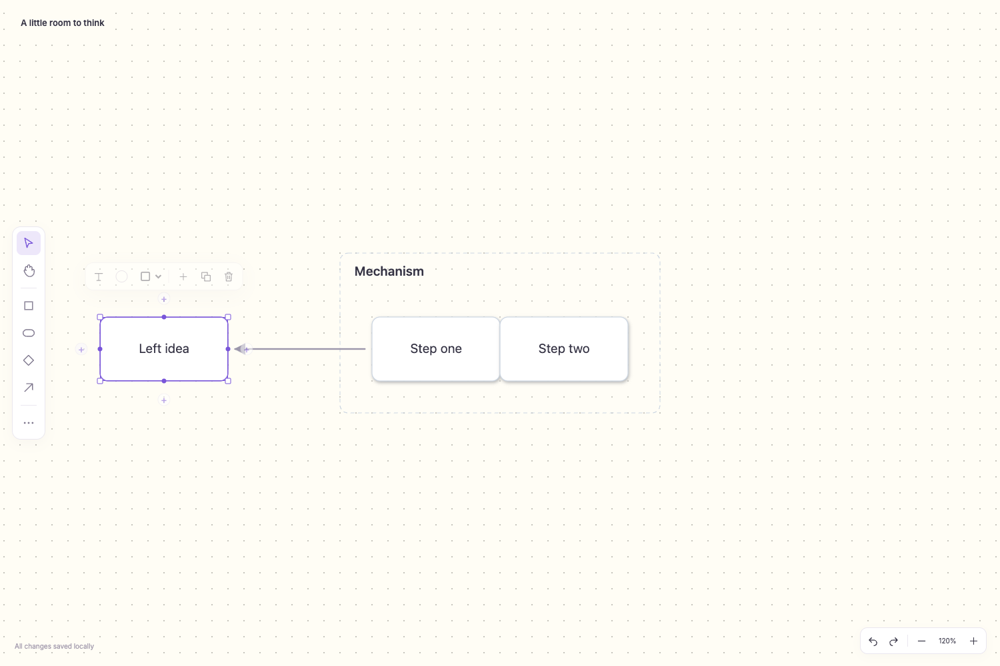

# REA Board

A small, local Mermaid board for Obsidian. Move your ideas freely while keeping the diagram as readable text.

[Support development on Ko-fi](https://ko-fi.com/theprasanjitsahoo) · [Releases](https://github.com/astreos108/rea-board/releases) · [Report a problem](https://github.com/astreos108/rea-board/issues)



REA Board is an independent community project. It is not affiliated with Obsidian, Whimsical, Miro, FigJam or Excalidraw. It is original software, not a fork or recovered implementation of those products.

## What it does

- Drag, resize and edit shapes directly. Resize a single side or a corner.
- Draw connections by dragging from centered ports; reconnect endpoints and adjust bends, segments and labels.
- Auto, straight and right-angle connectors, colors, wrapping labels, endpoint gaps, rounded elbows, automatic port/lane separation and crossing hops.
- Box/Shift selection, group move, duplicate, undo/redo, alignment guides and grid snapping. Alt bypasses snapping/guides. Alignment to another object takes priority over grid alignment.
- Genuine frames with saved membership. Drag a frame's title area to move it and its contents. Removing a frame keeps its contents. Frames do not nest.
- Align left/center/right/top/middle/bottom and distribute horizontal/vertical gaps from the selection toolbar.
- Four-direction quick add, Tab-to-add-child, hex backgrounds with Ivory/Ice/Sage shortcuts, optional dots, light/dark modes, keyboard presentation, floating filename rename and offscreen recovery.
- Paste Mermaid directly or through right-click → Paste. Import files. Copy selected shapes as Mermaid, PNG or SVG.
- Link to vault notes, headings and blocks. Optional external MCP bridge and reusable assistant skill.
- Optional character counter with a personal soft target; typing is never blocked. Live in-place text editing stays open across app/tab switches.
- Basic Markdown text: `**bold**`, `*italic*`, `==highlight==`, inline code, `[[Note|alias]]` and `[label](https://example.com)`. Command/Ctrl-click links to follow them; note titles/aliases appear instead of raw wiki syntax.
- Numbered/bullet list tools, selection wrapping with brackets/parentheses, text undo/redo and per-paragraph left/center/right/justify alignment. Select text or place the caret in a paragraph, then use the floating text toolbar; changes display immediately.
- Double-click a selected shape border/handle to fit text. Overflow keeps the full source and shows an ellipsis; the editing chevron expands the field. Frame titles edit from the header; double-click empty interior space to add a member.

## Install

This repository is independently downloadable. **Publication on GitHub does not mean the plugin has passed Obsidian Community review or is listed in the in-app directory.**

1. Download `main.js`, `manifest.json`, `styles.css` and `THIRD_PARTY_NOTICES.txt` from a [release](https://github.com/astreos108/rea-board/releases).
2. Create `CONFIG_DIR/plugins/rea-whimsical/` inside your vault and put the files there. `CONFIG_DIR` is your vault configuration folder, usually `.obsidian`.
3. Enable **REA Board** under Community plugins. Use the ribbon's easel icon or the **New board** command.

The historical plugin ID `rea-whimsical` remains stable for existing installations and MCP configuration. The product name is REA Board. Initial public support is **desktop Obsidian 1.13.0+**. Mobile is not declared supported until tested; desktop-only clipboard and optional transport adapters are guarded separately.

Existing Markdown notes with a Mermaid block can open through **Open current note as board**. Other Markdown content and later Mermaid blocks are retained. Conflicting saves are rejected rather than overwritten. Unsaved failed saves are retained in plugin data and can be restored **as a separate board** from plugin settings.

## Everyday controls

| Action | Control |
|---|---|
| Move / select | Drag a shape; Shift-click adds/removes from selection; drag blank canvas for a box selection |
| Edit | Double-click shape/label; Enter commits; Shift+Enter adds a line; Escape cancels |
| Connect | Drag a centered port onto a shape; drop on blank canvas to add a connected shape |
| Route | Select connector, then drag endpoints, bend/segment handles or label |
| Resize | Corner or side grips; opposite edge stays fixed |
| Frame | Select shapes → Frame selection; move the frame by its title area |
| Arrange | Multi-select → Arrange dropdown |
| Quick add | Plus controls around a selected shape or Tab |
| Copy PNG | Cmd/Ctrl+Shift+C; only selection, or all content when nothing is selected |
| Copy SVG | Right-click / More → Copy as SVG; Cmd/Ctrl+Alt+Shift+C also works |
| Copy editable objects | Cmd/Ctrl+C copies Mermaid; Cmd/Ctrl+V pastes additional shapes |
| Navigate | Space-drag / Pan tool; wheel pans; Cmd/Ctrl+wheel zooms; Cmd/Ctrl+0 fits |
| Rename | Click the small floating filename at upper left |
| Recovery | Zoom to content appears when you pan away |

Board shortcuts apply inside the Board surface; no global default hotkeys are registered. PNG copying uses up to 2× resolution, capped at 8192 pixels on the longest side. SVG includes styles/markers and excludes editing handles; target applications differ in their vector clipboard support.

## Mermaid ownership and compatibility

Each `.board` file is plain Mermaid. `%% board-layout:` comments preserve positions, sizes, routes, label offsets, links and explicit frame membership. Version 4 adds frames; versions 1–3 remain readable. Regular Mermaid renders the underlying graph using its own layout; it does not restore Board's free positioning or interactive containers. Color uses standard Mermaid styles where possible.

Editable flowcharts support rectangles, pills, decisions and frames. Basic non-nested Mermaid subgraphs import as frames. Unsupported subgraph syntax, sequence/class/state/ER diagrams and other Mermaid types remain renderable/editable as source. Source-only paste requires an empty board and never replaces an existing visual graph implicitly. Supported bounds are 300 objects, 1,000 connectors and 200,000 source characters; split larger maps into linked boards.

### Clipboard limits

Direct paste is implemented for Board/Mermaid, plain/rich text, basic Excalidraw JSON, basic tldraw JSON records, and SVG rectangles/circles/ellipses/text. Proprietary/compressed clipboard formats, complex paths, imported SVG connectors, rotations, freehand and raster images are **not fully supported**. Native editable paste from every version of Canva, FigJam, Lucidchart/Lucidspark, Miro, Mural, tldraw and Visio is not promised. Unsupported content gets an explanatory error/omission notice. Image-bearing Mermaid source is rejected before rendering to prevent implicit external asset requests. [Full compatibility and future work](research/whimsical-release-review.md).

Native frames store membership, not spatial proximity. Resizing a frame does not scale or clip its children; it may be resized around them. Connector lanes, gaps and hops are visual projections and do not add relationships. Dense maps and manually overlapping routes can still need manual correction.

Vault links open native notes/headings/blocks. `.board` links do **not** yet participate in automatic Markdown backlink indexing or target-rename rewriting.

## External assistants through MCP

There is **no embedded AI, model client or provider API key**. The bridge is **off by default**. Enable **External MCP bridge** in REA Board settings only if needed. Separately enable **Allow MCP note reading** if your assistant needs vault excerpts. The assistant is responsible for its own model connection and any data it sends to its provider.

Install this checkout's dependencies with `npm ci`, then configure your MCP client:

```json
{
  "command": "node",
  "args": ["/path/to/rea-board/mcp/server.mjs", "--bridge-file", "/path/to/vault/CONFIG_DIR/plugins/rea-whimsical/bridge.json"]
}
```

The eleven tools expose capabilities, board listing/read/create/edit/branch expansion/open, and opt-in note search/targets/excerpts. Every existing-board write needs a revision returned by `board_read`. Every semantic operation requires `type`:

```json
{"type":"create_frame","id":"mechanism","label":"Mechanism","ids":["a","b"]}
```

The [rea-board-map skill](skills/rea-board-map/SKILL.md) teaches map selection, source grounding, native frames, visual checks, relationship clarity and conflict handling. Copy its folder to your assistant's skills directory. Setup and fallback CLI usage are in its [reference](skills/rea-board-map/references/bridge-and-storage.md).

## Privacy and access disclosures

- **Vault read/write:** your board files and settings/recovery data. Note picker reads note titles/metadata. Note content reads through MCP require separate opt-in.
- **Clipboard:** read only when you paste; write only when you copy. Desktop PNG/SVG uses Electron's clipboard API.
- **Network:** core editing has no remote service. Optional MCP opens an authenticated listener on `127.0.0.1` with a fresh owner token. Browser Origin requests are rejected. The stdio adapter calls only that local listener. The Ko-fi button opens its external website only on click.
- **Filesystem:** optional desktop bridge writes an owner-only credential inside the vault's plugin configuration directory. The standalone Node MCP adapter reads the explicit credential path you configure. Board file operations use Obsidian's Vault/FileManager APIs.
- **Recovery:** failed-save snapshots contain board source in plugin `data.json`; treat it as private vault data and include it in your own backup policy.
- **No telemetry, advertisements, automatic updates or dependency installation at runtime.** Obsidian manages plugin updates; developers install build/MCP dependencies deliberately.
- **Free:** no accounts or payments required for core functionality. Ko-fi donations are optional and do not unlock features.

A local authenticated API is not a sandbox against malicious local software with access to your vault/credential. Other Obsidian plugins run with similar local privileges. Never share or commit `bridge.json`, private boards or recovery data. [Security policy](SECURITY.md).

## Develop and verify

Use Node **22.23.1** and npm **10.9.8** (see `.nvmrc` and `packageManager`).

```sh
npm ci --ignore-scripts
npm run check
npx playwright install chromium
npm run test:ui
npm run verify:reproducible
```

`check` runs the official Obsidian ESLint recommended configuration over plugin source and package metadata, formatting, domain/workflow tests, architecture checks and the build. Node-only tools and browser fixtures use separate lint scopes because they are not mobile/plugin code. No production rules are selectively disabled to improve scan results.

`verify:reproducible` installs and builds in two separate temporary directories and compares release bytes. CI repeats the check. Release workflows pin GitHub Actions by commit and generate GitHub build attestations and SHA-256 checksums. Build-time license discovery retains bundled dependency notices. Fresh dependency scans are CI gates; an audit reports known advisories, not proof of absence of vulnerabilities.

Live MCP tests require your own test vault and explicit `REA_BOARD_BRIDGE_FILE`. They create a unique separate test board. `REA_BOARD_TEST_NOTE` optionally exercises note targets when note reading is enabled. Never point integration tests at valuable user boards.

Read [ARCHITECTURE.md](ARCHITECTURE.md), [CONTRIBUTING.md](CONTRIBUTING.md) and [release readiness](docs/RELEASE_READINESS.md). A preview scan/approval from Obsidian remains an external review, not something local tests can certify.

## Sustainable support

Core editing, recovery, export and local MCP remain free. A small heart in More and the native preferences page link to optional Ko-fi support. No payment unlocks features. [Funding research and future options](docs/SUSTAINABILITY.md).

## Credits and license

MIT © 2026 Prasanjit Sahoo. Mermaid, DOMPurify and the MCP SDK retain their upstream licenses; bundled notices are generated in `THIRD_PARTY_NOTICES.txt` and release assets. REA was used earlier for public-page interface research; its code is not bundled or copied into this original plugin. Whimsical's public releases informed feature prioritization, not implementation recovery.

### Writing details

The counter is a **soft target**, off by default, configured in More or REA Board settings. It counts visible Unicode grapheme characters, including spaces and line breaks, while excluding Markdown markers and hidden link destinations; it is not Twitter's weighted URL counting algorithm. No truncation or payment gate is applied.

The editor displays supported formatting live on the shape, with no separate white text field. Frame titles edit at their header text. Markdown is retained in the Mermaid label source. A small link-target popover changes destinations without exposing Markdown syntax. This is a focused rich editor, rather than Obsidian's full Markdown editor. Embedded images, callouts, tables and plugin-provided Markdown extensions are not promised. Use Shift+Enter for an ordinary new line; Enter continues a list, an empty list item ends it, and Command/Ctrl+Enter or the checkmark commits. Escape cancels the current edit. Alignment applies to selected source paragraphs and may differ between paragraphs; ordinary justify leaves the final wrapped line ragged.

App/window blur leaves the current field open. Navigating away from a Board saves and caches its active draft/cursor for restoration within that running Obsidian session. This session cache is not a cross-device or crash-recovery history. Version 5 layout comments persist paragraph alignment; older Board versions safely treat those files as source-only rather than silently deleting alignment metadata.

Grid dots use fixed world-space levels at 20, 100 and 500 units. Their origin stays attached to the board during pan and zoom. Fine marks fade from use when too dense; snapping remains at 20 units. Existing off-grid positions and manually chosen dimensions are preserved rather than silently changing your layout.

Connector edits show **teal** alignment guides, distinct from red shape guides. Midpoints and quarter-points use magnets no larger than four screen pixels (and smaller on short edges). A small teal marker shows an exact snap. Other attachment positions stay adjustable; hold Alt to bypass guides, magnets and grid snapping. Empty frame backgrounds are not connector targets.
